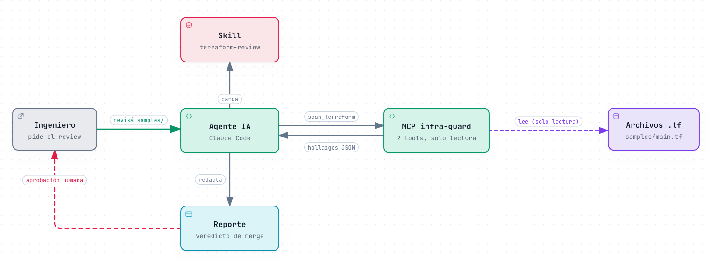

# 🛡️ AI Cloud Demo: Skill + MCP para revisar Terraform

Proyecto chico que muestra cómo se combinan **MCP** y **Skills** en un agente de IA, aplicado a un caso real de Cloud/DevOps: revisar infraestructura como código antes de hacer merge.

> **MCP son las manos. La Skill es el manual.**

---

## 📌 Qué problema resuelve

Revisar PRs de Terraform es repetitivo: siempre se miran las mismas cosas (puertos abiertos, cifrado, tags). Es un buen candidato para automatizar con IA porque tiene **criterios claros** y el **riesgo es bajo** si el agente solo propone y un humano aprueba.

## 🧩 Conceptos en 30 segundos

| Concepto | Qué es | En este proyecto |
|---|---|---|
| **LLM** | Modelo que entiende y genera texto y código | El cerebro (Claude) |
| **Agente** | LLM + herramientas + loop (piensa, actúa, mira el resultado, repite) | Claude Code |
| **MCP** | Estándar abierto para conectar la IA con sistemas externos | Servidor `infra-guard` |
| **Skill** | Carpeta con instrucciones que el agente carga solo cuando hace falta | `terraform-review` |

**¿Cuál es la diferencia entre MCP y Skill?**

- **MCP** responde *"¿a qué puede acceder?"*: da herramientas.
- **Skill** responde *"¿cómo lo hacemos acá?"*: da procedimiento y criterio.

## 🏗️ Arquitectura



> Versión interactiva (con rutas animadas y modo oscuro): descargá [`docs/arquitectura.html`](docs/arquitectura.html) y abrila en el navegador. Generada con [Archify](https://github.com/tt-a1i/archify).

## 📁 Estructura

```
ai-cloud-demo/
├── .mcp.json                                  # registra el MCP al abrir Claude Code
├── .claude/skills/terraform-review/SKILL.md   # la Skill
├── mcp-server/
│   ├── index.js                               # servidor MCP (Node)
│   └── package.json
├── samples/main.tf                            # Terraform con errores a propósito
├── samples/network.tf                         # mal formateado a propósito (warning de fmt)
├── samples/ok/main.tf                         # versión corregida: debería dar "aprobar"
└── docs/arquitectura.{png,html}               # diagrama (generado con Archify)
```

## 🔌 Tools del MCP `infra-guard`

| Tool | Qué hace | Permisos |
|---|---|---|
| `scan_terraform` | Escanea `.tf`, suma el chequeo de `fmt` y devuelve hallazgos ordenados por severidad | Solo lectura |
| `check_terraform_fmt` | Corre `terraform fmt -check` (o `tofu fmt`) y devuelve los archivos sin formatear con su diff | Solo lectura |
| `get_tagging_standard` | Devuelve los tags obligatorios (`Owner`, `Environment`, `CostCenter`) | Solo lectura |

### Reglas implementadas

| Severidad | Regla | Qué detecta |
|---|---|---|
| 🔴 Alta | `SG_ADMIN_PORT_OPEN` | Puerto 22 o 3389 abierto a `0.0.0.0/0` |
| 🔴 Alta | `RDS_PUBLIC` | `publicly_accessible = true` |
| 🟠 Media | `RDS_NOT_ENCRYPTED` | RDS sin `storage_encrypted = true` |
| 🟠 Media | `S3_NO_SSE` | Bucket sin configuración de cifrado |
| 🟡 Baja | `MISSING_TAGS` | Faltan tags obligatorios |
| ⚪ Warning | `FMT_NOT_FORMATTED` | Archivo que `terraform fmt` reformatearía (estilo, no bloquea) |

## 🚀 Cómo correrlo

**Requisitos:** Node 18+ y [Claude Code](https://claude.com/claude-code). Opcional: `terraform` o `tofu` en el PATH para el chequeo de formato (si no están, ese chequeo se omite y el reporte lo avisa).

```bash
git clone https://github.com/chark707/ai-cloud-demo.git
cd ai-cloud-demo
(cd mcp-server && npm install)
claude
```

La primera vez, Claude Code pide aprobar el servidor `infra-guard` (viene de `.mcp.json`). Verificá con `/mcp`. Después pedile:

```
Revisá la carpeta samples/ con la skill terraform-review
```

## ✅ Resultado esperado

Sobre `samples/` el scanner encuentra **7 hallazgos**: 2 altos, 2 medios, 2 bajos y 1 warning de `fmt` (`network.tf`, mal formateado a propósito). El agente:

1. Carga la Skill porque su descripción coincide con el pedido.
2. Llama a `scan_terraform` y `get_tagging_standard`.
3. Verifica cada hallazgo leyendo el código (el scanner es simple y puede dar falsos positivos).
4. Entrega un reporte con veredicto **`bloquear merge`** y los fixes como propuesta.

**No modifica ningún archivo.**

## 🔒 Decisiones de diseño

- **Solo lectura.** Las tools no ejecutan `terraform` ni tocan AWS.
- **Humano en el loop.** El agente propone, una persona aprueba.
- **Determinístico + IA.** El scanner cubre lo fijo; el agente aporta contexto, priorización y redacción.

## ⚠️ Límites

- El scanner usa **regex**, no un parser HCL real. No resuelve variables ni módulos.
- Es una demo del patrón, **no reemplaza** a [tfsec/Trivy](https://github.com/aquasecurity/trivy) o [Checkov](https://www.checkov.io/).

## 🔭 Ideas para extender

- Tool `terraform_plan_summary` que lea `terraform show -json`.
- MCP de GitHub para comentar directamente en el PR.
- Correrlo en CI en cada PR de infraestructura.
- Más reglas: IAM con `*`, backups, tipos de instancia permitidos.
- Mismo patrón para otros casos: triage de incidentes, FinOps, documentación de post-mortems.

## 📄 Licencia

MIT

## 👋 Autor

Hecho por **Charles Samudio**, Cloud / Platform Engineer (AWS, Terraform, IaC) en Buenos Aires. Armé esto para practicar IA aplicada a infraestructura. Estoy abierto a nuevas oportunidades: [linkedin.com/in/chars-samudio](https://www.linkedin.com/in/chars-samudio)
